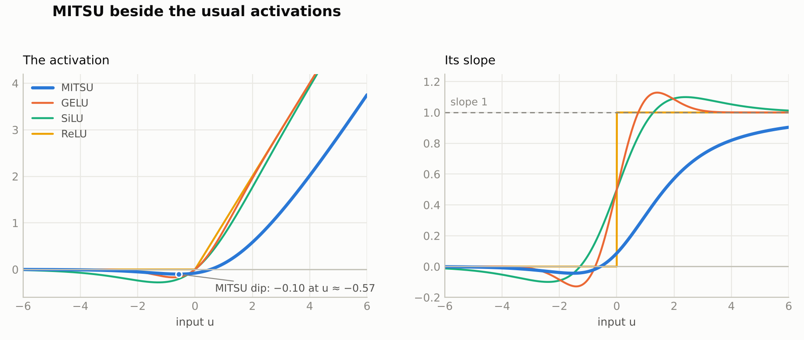

# MITSU 三つ巴 — v1.0.1

A parameter-free activation derived from a symmetric three-variable expression,
with NumPy and PyTorch implementations, an interactive lab, and reproducible
small-model experiments.

```text
mother function: f(x,y,z) = (x^(y+z) + y^(x+z) + z^(x+y)) / (x+y+z)
activation:      MITSU(u) = s(s-1)/(s+2), s = softplus(u)
```



## What changed in v1.0.1

1. Safer numerical evaluation, including the FP16 overflow regression, with
   dtype and gradient tests.
2. Paired confidence intervals and explicit practical-equivalence margins;
   a nonsignificant difference is no longer automatically labelled parity.
3. A larger, multi-seed CPU pilot and 1,000-step exploratory extension, with
   raw results, locally frozen protocols,
   uncertainty intervals, and recorded stability diagnostics.
4. A precise explanation of the scaled gate and full-block gradient paths.
5. An installable versioned package, tested dependency pins, CI, and measured
   timing and tensor-storage benchmarks.
6. A pre-registered test of the seat-weight constant c in s(s-1)/(s+c), where
   c = 2 is the current activation (experiment 06).

See [CHANGELOG.md](CHANGELOG.md), [installation](docs/INSTALLATION.md),
[statistical interpretation](docs/STATISTICS.md), and [stability](docs/STABILITY.md).
The complete original experiments, trained character-model checkpoints and
interactive lab are retained.

## Install and use

```bash
python -m pip install .
# For PyTorch, install a suitable torch build first (CPU example):
python -m pip install torch --index-url https://download.pytorch.org/whl/cpu
python -m pip install '.[torch]'
```

NumPy:

```python
import numpy as np
from mitsu import mitsu, mitsu_d
u = np.linspace(-4, 4, 9)
y, dy = mitsu(u), mitsu_d(u)
```

PyTorch:

```python
from mitsu_torch import MITSU, MitsuGLU
act = MITSU()
ffn = MitsuGLU(dim=512, hidden_dim=1365, gate_mult=3.0374)
```

`MITSU` has no trainable parameters and preserves tensor shape. The PyTorch
implementation promotes FP16/BF16 arithmetic internally to float32 and casts
back. The historical `torch/` files remain available for standalone copying.
The optional PyTorch dependency is unnecessary for NumPy-only use.

`gate_mult=3.0374` is the historical pilot's standard-deviation matching choice
under standard-normal inputs; the module default is 1.0. This gain also
multiplies the derivative. It does not establish training stability or match
every layer's signal distribution. See [the derivation](docs/STABILITY.md).

## The core function

Set x = s = softplus(u), y = z = 1 in the symmetric expression. This gives
f(s,1,1) = (s²+2)/(s+2). Subtract its limiting value 1 as u tends to negative
infinity to obtain MITSU. Here “silence” means that limiting input, not u = 0.

The activation is smooth and non-monotonic, with minimum approximately
-0.10102 at u approximately -0.5665. It tends to 0 on the left and approaches
u-3 on the right. Its exact unscaled scalar derivative is

```text
m'(u) = [1 - 6/(softplus(u)+2)^2] sigmoid(u),  -0.5 < m'(u) < 1.
```

The bound is deliberately loose. The numerical implementation uses an
algebraically equivalent evaluation that avoids the overflowing intermediate
product in s(s-1). The underlying activation formula is unchanged.

## Evidence and limits

The experiments support feasibility on the tested tasks. They do not establish
superiority to GELU/SiLU, an industrial-scale scaling law, or fewer loss spikes
in large models. Practical equivalence is a specific confidence-interval
conclusion within a stated margin; it is not inferred merely from p > 0.05.

| Experiment | What is included | Scope |
|---|---|---|
| [01 Classification](experiments/01_classification) | NumPy MLPs, MNIST/Fashion-MNIST and bundled datasets, five seeds | Historical small-model comparisons |
| [02 Character GPT](experiments/02_char_gpt) | Paired Tiny Shakespeare models and trained weights | One historical paired run; Δ loss +0.0045 nats |
| [03 Nano ladder](experiments/03_scaling_ladder) | Four paired sizes, 31,936–483,184 parameters | One seed per size; four points cannot establish an 8B extrapolation |
| [04 Dial family](experiments/04_dial_family) | 29 variants and 472 historical result records | New post hoc CI reports alongside unchanged historical results |
| [05 Multi-seed scaling](experiments/05_multiseed_scaling) | 997,632 / 1,756,160 parameters, three paired seeds, 100 / 1,000 steps | Separate correlated horizons; no large-model stability claim |
| [06 Seat weights](experiments/06_seat_weights) | Six fixed values of c in s(s-1)/(s+c) and a learnable c; 91 pre-registered records | No value confirmed better than c = 2 (current MITSU); small models only |
| [Performance](benchmarks) | CPU timing and tensor-storage measurements; CUDA-capable harness | Hardware/dtype-specific measurements, no unmeasured GPU claims |

The 1,000-step extension reports the following descriptive paired differences
(MitsuGLU minus SwiGLU; lower favors MITSU):

| Parameters | Mean loss delta, nats | Paired 95% CI |
|---:|---:|---|
| 997,632 | +0.003756 | [-0.032176, +0.039687] |
| 1,756,160 | +0.001593 | [-0.096138, +0.099325] |

These observations do not establish an advantage. Both families recorded zero
defined loss spikes/divergences over this limited exposure. The 100-step pilot
and extension reuse the same trajectories and are not independent replication.
See the [full extension report](experiments/05_multiseed_scaling/results/extension/REPORT.md).

MITSU costs more to compute than the built-in gates. On the recorded CPU the bare
activation's forward pass took 10–16 times as long as SiLU's, a gated feed-forward
block took 7–52% longer, and the MitsuGLU models of experiment 05 trained about
20% slower than their SwiGLU twins over 1,000 updates. No GPU timing has been
measured. See [the benchmark results](benchmarks/RESULTS.md).

Original preregistrations and historical result files remain intact. New
v1.0.1 analyses are labelled separately; they do not retroactively become
pre-registered. The experiment 05 local freeze records file hashes before
its official runs, without claiming an independent public timestamp.

## Test and reproduce

```bash
python -m pip install -e '.[dev,torch,experiments]'
python -m pytest -q
python experiments/04_dial_family/gate.py
python experiments/04_dial_family/analyze.py
python experiments/04_dial_family/analyze.py _confirm
python experiments/06_seat_weights/gate.py
python experiments/06_seat_weights/analyze_ci.py
```

The new analysis writes versioned reports and summaries, preserving historical
ones. Each experiment and the benchmark folder provide their own exact run
commands. [VALIDATION.md](VALIDATION.md) records release checks and their scope.

Historical NumPy gradient checks:

```bash
python experiments/02_char_gpt/mitsu_gpt.py gradcheck
python experiments/03_scaling_ladder/ladder.py gradcheck
```

The [interactive lab](lab/mitsu-activation-lab.html) can be opened directly in a
browser. It has no build step; its external font is optional. Its visual
experiments are separate from the measured Python benchmark harnesses.

## Repository map

```text
mitsu.py                         NumPy reference and derivative
mitsu_torch/                     installable PyTorch activation and gated FFN
torch/                           legacy standalone copy files
tests/                           mathematical, numerical, statistical and integration tests
benchmarks/                      performance harness and measured CPU results
lab/                             interactive HTML lab
experiments/01_classification/   historical classification experiments
experiments/02_char_gpt/         historical NumPy transformer and checkpoints
experiments/03_scaling_ladder/   historical four-point nano ladder
experiments/04_dial_family/      historical variant grid plus v1.0.1 CI reports
experiments/05_multiseed_scaling/ multi-seed short-horizon pilot and longer-run profile
experiments/06_seat_weights/     pre-registered test of the seat-weight constant c
docs/                            installation, statistical and stability explanations
```

## License and citation

MIT. See [LICENSE](LICENSE) and [CITATION.cff](CITATION.cff).
Evan David Little · EL Innovations Inc. · Whitby, Ontario · 2026.
