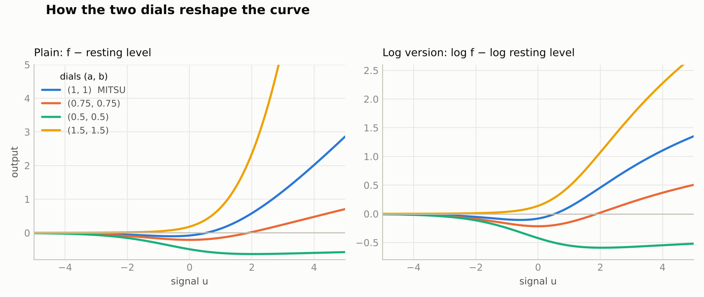
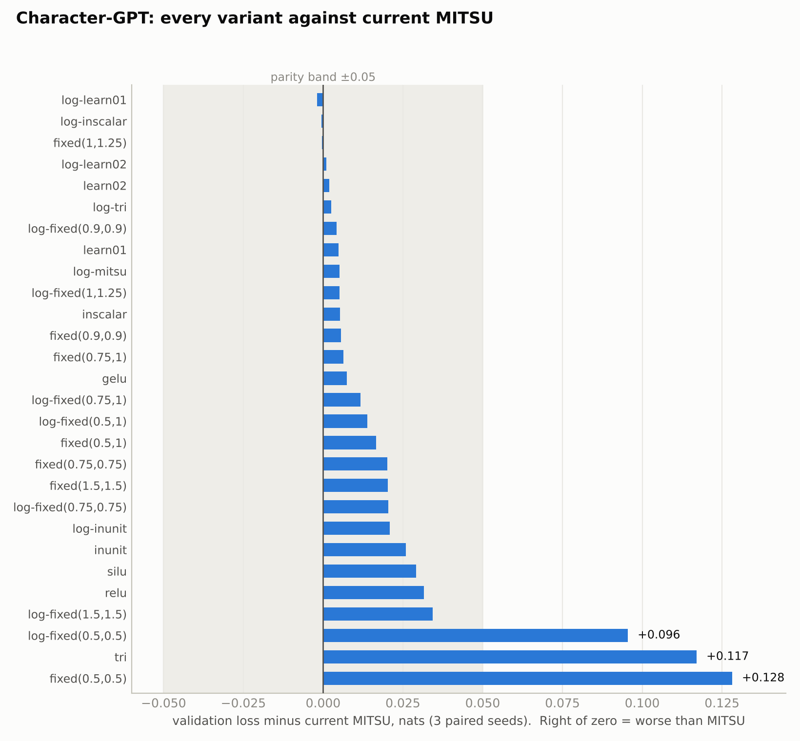

# 04 · The dial family — MITSU variants

Every way of filling the three seats of the MITSU mother function, tested against current
MITSU under a pre-registered protocol.

    f(x, y, z) = (x^(y+z) + y^(x+z) + z^(x+y)) / (x + y + z)

Current MITSU puts the signal in seat x and sets the other two seats to 1:
`MITSU(u) = s(s−1)/(s+2)` with `s = softplus(u)`. This repository asks what happens when
seats y and z ("the dials") are anything else.

**Result: no variant is confirmed better than current MITSU.** 29 variants, 472 training runs,
three benchmarks. Full report: [`results7.md`](results7.md). Pre-registration, frozen before
the first run: [`prereg7.md`](prereg7.md).

The benchmarks are inherited from experiments 01 and 02 (prereg3 for classification,
prereg4 for the character-GPT).

## The variants

Seat x always carries the signal, `s = softplus(u)`. Each form is centred by subtracting its
resting level `(a^b + b^a)/(a + b)`, so a silent input gives 0 and `a = b = 1` is exactly MITSU.

| family | seats y, z | names in the code | extra cost |
|---|---|---|---|
| Current MITSU | 1, 1 | `mitsu` | none |
| Fixed dials | two constants (a, b) | `fixed(0.9,0.9)` `fixed(0.75,1)` `fixed(0.5,1)` `fixed(0.75,0.75)` `fixed(0.5,0.5)` `fixed(1,1.25)` `fixed(1.5,1.5)` | none |
| Learnable dials | one learned pair per layer | `learn01` (range 0.05–1, starts 0.955), `learn02` (range 0.05–1.95, starts at 1) | 2 numbers per layer |
| Input-driven dials | computed from the layer's own input | `inscalar` (one pair per example or token), `inunit` (one pair per unit) | small extra layer / 3× weights per unit |
| Three-seat competition | three different signals | `tri` (the tri block of experiment 01, unchanged) | 3× weights per unit |
| Log version | log f of any row above | `log-…` prefix on each name | none |

ReLU, GELU and SiLU are included as references.



What the dials do to the shape:

- **Both dials at 1** — the only setting whose right-hand tail is a straight line with no
  exponential term.
- **Dials below 1** — the tail grows more slowly than a line; at (0.5, 0.5) the curve
  flattens out below zero and stops responding to large signals.
- **Any dial above 1** — the tail grows exponentially.
- **Log version** — the same ordering, compressed; nothing can overflow.

## Results

Δ is variant minus `mitsu`, paired on the same seeds. Accuracy: higher is better. Loss: lower is
better. ▲ / ▼ = passed the pre-registered screen as better / worse than `mitsu`.

| family | variant | MNIST acc % | Fashion-MNIST acc % | char-GPT loss, nats |
|---|---|---|---|---|
| Baseline | `mitsu` | 95.04 | 84.33 | 1.7446 |
| Fixed, below 1 | `fixed(0.9,0.9)` | +0.16 | +0.57 ▲ | +0.006 ▼ |
| | `fixed(0.75,0.75)` | −0.11 | +0.57 ▲ | +0.020 ▼ |
| | `fixed(0.5,0.5)` | −1.97 ▼ | +0.01 | +0.128 ▼ |
| Fixed, above 1 | `fixed(1,1.25)` | diverged 5/5 | diverged 5/5 | −0.0003 (tie) |
| | `fixed(1.5,1.5)` | diverged 5/5 | diverged 5/5 | +0.020 ▼ |
| Learnable | `learn01` | +0.09 | +0.25 ▲ | +0.005 |
| | `learn02` | diverged 5/5 | +0.06 | +0.002 |
| Input-driven | `inscalar` | −0.55 | +0.17 | +0.005 |
| | `inunit`, matched params | −1.61 ▼ | −0.52 ▼ | +0.026 |
| Three-seat | `tri`, matched params | −2.05 ▼ | −0.90 ▼ | +0.117 ▼ |
| Log | `log-mitsu` | −0.49 | +0.34 ▲ | +0.005 |
| | `log-fixed(1.5,1.5)` | −0.13 | +0.30 | +0.034 ▼ |
| | `log-tri`, matched params | −1.50 ▼ | −0.62 ▼ | +0.003 |

All 29 variants, with standard errors and t values: [`results7.md`](results7.md) and
[`results/tables_main.txt`](results/tables_main.txt).



What the tests showed:

- **Nothing beat (1, 1).** Nine variants passed the first-round screen on Fashion-MNIST. None
  repeated it on five fresh seeds, and six of the nine were measurably worse on the character-GPT.
- **On the character-GPT, (1, 1) sits at the bottom of the bowl.** Every fixed setting below 1
  was worse, and worse the further below. Above 1, one setting tied and one was worse.
- **Dials above 1 need normalisation in front of them.** They blew up in the plain classifier
  and trained normally in the layer-normalised transformer.
- **Learnable dials are harmless and gain nothing.** The two dials start equal and the formula is
  symmetric, so they stay equal: it is one learned number per layer.
- **Per-unit input-driven dials and the three-seat block do not pay for their extra weights.**
- **The log version is a safety device, not an improvement.** It made above-1 dials trainable on
  the image sets and brought the three-seat block to parity on the character-GPT.

Most character-GPT gaps are inside the ±0.05-nat parity band of prereg4. Only `fixed(0.5,0.5)`
and `tri` are meaningfully worse.

## Use a variant

```python
import torch
from variants import dial, tri, specs, Layer

u = torch.randn(8, 64)

y = dial(u, 1.0, 1.0)              # current MITSU
y = dial(u, 0.75, 0.75)            # fixed dials
y = dial(u, 1.0, 1.25, log=True)   # log version
y = tri(torch.randn(8, 64, 3))     # three-seat block: (..., N, 3) -> (..., N)

# A full layer (linear map + variant), as used by both benchmarks.
he = lambda out_f, in_f: torch.randn(out_f, in_f) * (2.0 / in_f) ** 0.5
layer = Layer(specs()["learn01"], d_in=64, width=128, init_w=he)
h = layer(u)                       # (8, 128)
print(layer.dials())               # the learned pair for this layer
```

`specs()` lists all 29 names. Everything is plain autograd; there is no custom backward.

## Reproduce

Needs Python 3, numpy and PyTorch (CPU is enough). Run from this folder.

```bash
./get_data.sh                           # MNIST, Fashion-MNIST, Tiny Shakespeare (42 MB)
python3 gate.py                         # sanity gate; must print GATE: PASS
python3 bench_cls.py mnist 0 1 0 5      # <dataset> <worker> <nworkers> <seed0> <seed1>
python3 bench_cls.py fashion 0 1 0 5
python3 bench_gpt.py 0 1 0 3            # <worker> <nworkers> <seed0> <seed1>
python3 analyze.py                      # paired tables, writes results/summary.json

# confirmation run on fresh seeds: candidates plus mitsu, separated by ";"
python3 bench_cls.py fashion 0 1 5 10 _confirm "mitsu;gelu;fixed(0.75,0.75);log-fixed(0.75,0.75);fixed(0.9,0.9);fixed(0.75,1);log-fixed(0.75,1);fixed(0.5,1);log-mitsu;learn01;log-learn01"
python3 analyze.py _confirm
```

Runs append to `results/*.jsonl` and skip anything already there, so delete those files to start
clean. To use two cores, start two workers: `... 0 2 ...` and `... 1 2 ...`. On one core the
classification runs take about 25 minutes and the character-GPT about 3 hours.

## Files

| file | what it is |
|---|---|
| `variants.py` | every variant, plus the `Layer` wrapper used by both benchmarks |
| `gate.py` | sanity gate: closed forms, resting levels, autograd against finite differences, extreme inputs |
| `bench_cls.py`, `bench_gpt.py` | the two benchmarks |
| `analyze.py` | paired statistics against `mitsu` |
| `prereg7.md`, `FROZEN.txt` | pre-registration and the file hashes at freeze time |
| `results7.md` | the report: tables, confirmation run, prediction scorecard, exploratory checks, caveats |
| `results/` | one JSON line per training run, summaries and printed tables |
| `logs/` | console output of every run |
| `exploratory.py`, `check_numbers.py`, `make_tables.py`, `make_figures.py` | pooled analysis, independent recomputation, table and figure builders |

## Limits

- Small scale: 55k-parameter classifiers and a 111k-parameter transformer, 5 and 3 seeds.
  Nothing here says how a variant behaves at scaling-ladder size.
- Raw formulas with no gain multiplier. MitsuGLU was not part of this test.
- One inherited learning rate per benchmark, not tuned per variant.
- The harness is new PyTorch autograd code, not the numpy code of experiments 01–03. As a
  check, `mitsu` scored 95.04% on MNIST here against 95.00% in experiment 01.
- The two bench scripts differ from their `FROZEN.txt` hashes by one line: the separator of an
  optional command-line list changed from "," to ";" after the freeze. The authorship line of
  `prereg7.md` was also edited after the runs. Details in `results7.md`.

## Licence

Evan David Little · EL Innovations Inc. MIT — see [`LICENSE`](../../LICENSE) at the repository root.
