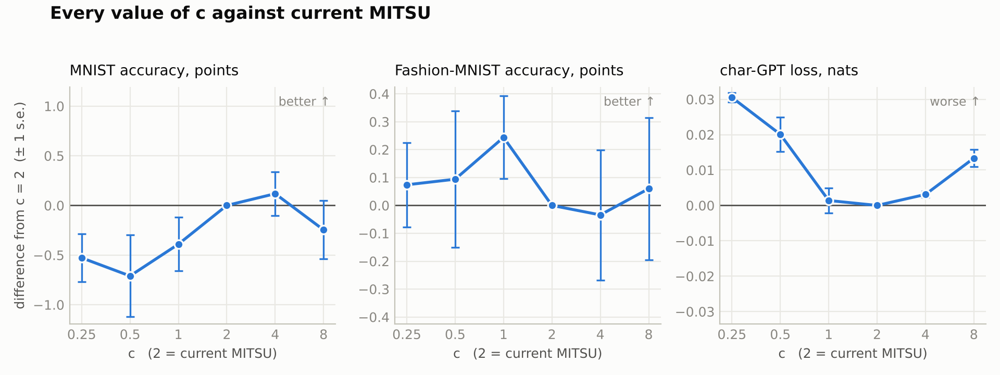
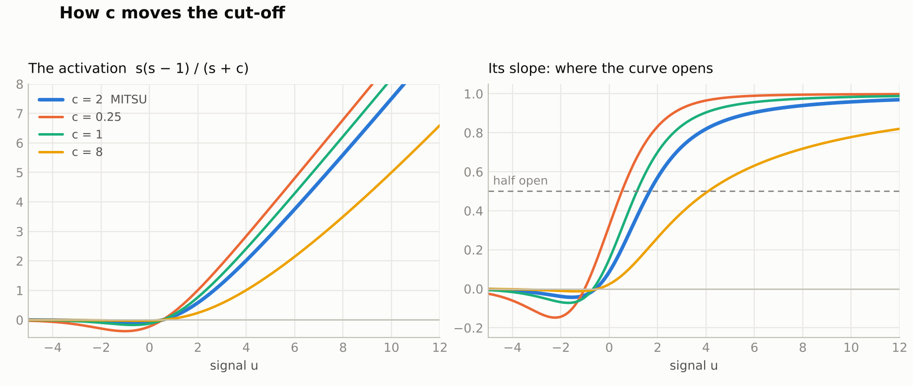

> v1.0.1 adds paired confidence intervals and conservative practical-equivalence
> decisions in `results/report_v1_0_1.md` (run `python analyze_ci.py`). The tables
> below keep the pre-registered wording; a difference that is not significant does
> not by itself establish parity. See [STATISTICS.md](../../docs/STATISTICS.md).

# 06 · Seat weights — the c family

What happens when each seat of the mother function gets its own weight:

    f(x, y, z) = (i·x^(y+z) + j·y^(x+z) + k·z^(x+y)) / (i·x + j·y + k·z)

With the signal in seat x and seats y = z = 1, the three weights collapse into one number:

    MITSU_c(u) = s(s − 1) / (s + c),    s = softplus(u),    c = (j + k) / i

`c = 2` is current MITSU. A small c gives a deeper dip and a unit that opens early; a large c
gives a shallow, quiet unit that opens late.

**Result: no value of c is confirmed better than c = 2.** Full report:
[`results8.md`](results8.md). Pre-registration, frozen before the first run:
[`prereg8.md`](prereg8.md).



| variant | MNIST acc % | Fashion-MNIST acc % | char-GPT loss, nats |
|---|---|---|---|
| `c=0.25` | −0.53 | +0.07 | +0.031 ▼ |
| `c=0.5` | −0.71 | +0.09 | +0.020 |
| `c=1` | −0.39 | +0.24 | +0.001 |
| **`mitsu` (c = 2)** | **95.04** | **84.33** | **1.7446** |
| `c=4` | +0.12 | −0.03 | +0.003 |
| `c=8` | −0.25 | +0.06 | +0.013 ▼ |
| `learnc` (one learned c per layer) | +0.08 | −0.15 | −0.002 |

Differences are variant minus `mitsu`, paired on the same seeds. ▼ = passed the pre-registered
screen as worse; nothing passed it as better. 91 runs, no divergences.

- **On the character-GPT, c = 2 is at the bottom of a shallow bowl.** 1 and 4 tie with it; 0.25,
  0.5 and 8 are slightly worse.
- **On the image sets, every value is within noise.**
- **A learnable c gains nothing.** Left free, it settles between about 1.3 and 2.1.

## Can c act as a filter?

Yes, as the cut-off of an amplitude gate: it sets how large a signal must be before the unit
passes it on. It is not a frequency filter. These checks are exploratory.



- The input at which the unit is half open moves from u = 0.5 at c = 0.25 to u = 4.1 at c = 8.
- On a test signal of spikes in noise, the spike-to-noise ratio goes from 8 at the input to 30
  after current MITSU and 47 at c = 8 (ReLU 11, GELU 12). A larger c also keeps less of the spike.
- Given one c per unit, the networks kept almost every unit between 1.5 and 2.5 and accuracy did
  not change. They did not use c as a strong filter.

## Use it

```python
import torch
from variants import mitsu_c, specs, Layer

u = torch.randn(8, 64)
y = mitsu_c(u, 2.0)      # current MITSU
y = mitsu_c(u, 0.5)      # opens earlier, deeper dip
y = mitsu_c(u, 8.0)      # opens later, quieter

he = lambda out_f, in_f: torch.randn(out_f, in_f) * (2.0 / in_f) ** 0.5
layer = Layer(specs()["learnc"], d_in=64, width=128, init_w=he)
h = layer(u)             # (8, 128)
print(layer.dials())     # the learned c for this layer
```

## Reproduce

Needs Python 3, numpy and PyTorch (CPU is enough). Run from this folder.

```bash
./get_data.sh                           # MNIST, Fashion-MNIST, Tiny Shakespeare (42 MB)
python3 gate.py                         # sanity gate; must print GATE: PASS
python3 bench_cls.py mnist 0 1 0 5      # <dataset> <worker> <nworkers> <seed0> <seed1>
python3 bench_cls.py fashion 0 1 0 5
python3 bench_gpt.py 0 1 0 3            # <worker> <nworkers> <seed0> <seed1>
python3 analyze.py                      # paired tables, writes results/summary.json
python3 analyze_ci.py                   # v1.0.1 confidence-interval report
python3 exploratory_unit.py cls         # exploratory: one learned c per unit
python3 exploratory_unit.py gpt
python3 filter_check.py                 # exploratory: the filter checks
```

Runs append to `results/*.jsonl` and skip anything already there, so delete those files to start
clean.

## Files

| file | what it is |
|---|---|
| `variants.py` | `mitsu_c`, the weighted mother function, and the `Layer` wrapper |
| `gate.py` | sanity gate: closed form, weights collapse to c, resting level, autograd, extremes |
| `bench_cls.py`, `bench_gpt.py` | the two benchmarks, as in experiment 04 |
| `analyze.py` | paired statistics against `mitsu`, as pre-registered |
| `analyze_ci.py` | v1.0.1 post hoc confidence intervals and equivalence report |
| `prereg8.md`, `FROZEN.txt` | pre-registration and the file hashes at freeze time |
| `results8.md` | the report: tables, prediction scorecard, the filter question, caveats |
| `exploratory.py`, `exploratory_unit.py`, `filter_check.py` | exploratory analyses, labelled as such |
| `results/`, `logs/` | one JSON line per training run, printed tables, console output |

## Licence

Evan David Little · EL Innovations Inc. MIT — see [`LICENSE`](../../LICENSE) at the repository root.
