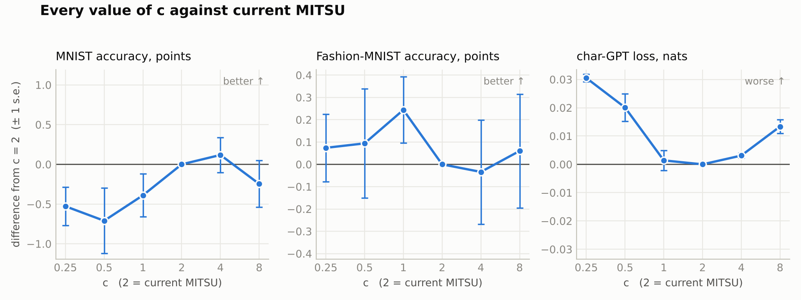
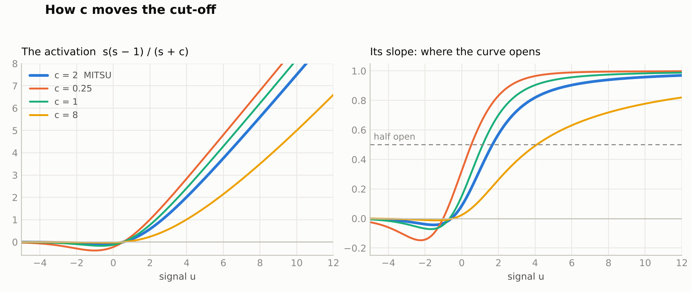

# Results 8 — seat weights (the c family), reported against prereg8

Evan David Little, 2026-11-10.
Pre-registration: `prereg8.md`, frozen 23:50 UTC before any benchmark run (hashes in `FROZEN.txt`).
91 pre-registered training runs (70 classification, 21 character-GPT) plus 13 exploratory ones.

## Headline

**No value of c is confirmed better than c = 2, the current MITSU.** Prediction P7 held.

- No variant passed the screen as better on any benchmark, so no confirmation run was triggered.
- On the character-GPT, **c = 2 sits at the bottom of a shallow bowl**: 1 and 4 tie with it, and
  0.25, 0.5 and 8 are worse by 0.013–0.031 nats. A parabola through the six points puts the
  minimum at c = 2.1.
- On the image sets every value of c is within noise of c = 2.
- A learnable c costs nothing and gains nothing. Left free, it settles a little below 2.
- No run diverged.

## What was tested

Weighted mother function, with a weight on each seat:

    f(x, y, z) = (i·x^(y+z) + j·y^(x+z) + k·z^(x+y)) / (i·x + j·y + k·z)

With the signal in seat x and seats y = z = 1, the three weights act through one number:

    MITSU_c(u) = s(s − 1) / (s + c),    s = softplus(u),    c = (j + k) / i

Seven variants: c = 0.25, 0.5, 1, 2 (`mitsu`), 4, 8, and `learnc` (one learned c per layer,
starting at exactly 2). Benchmarks and decision rules are those of prereg7.

Harness check: `mitsu` reproduced the prereg7 numbers exactly (MNIST 95.04, Fashion-MNIST 84.33,
char-GPT 1.7446).

## Results

Δ is variant minus `mitsu`, paired on the same seeds. Accuracy: higher is better. Loss: lower is
better. ▼ = passed the pre-registered screen as worse (|t| ≥ 2.78 with 5 seeds, ≥ 4.30 with 3).
No variant passed it as better.

| variant | MNIST acc % (Δ) | Fashion acc % (Δ) | char-GPT loss (Δ) |
|---|---|---|---|
| `c=0.25` | 94.51 (−0.53) | 84.41 (+0.07) | 1.7751 (+0.0305) ▼ |
| `c=0.5` | 94.33 (−0.71) | 84.43 (+0.09) | 1.7646 (+0.0201) |
| `c=1` | 94.65 (−0.39) | 84.58 (+0.24) | 1.7459 (+0.0014) |
| `mitsu` (c = 2, baseline) | 95.04 | 84.33 | 1.7446 |
| `c=4` | 95.16 (+0.12) | 84.30 (−0.03) | 1.7477 (+0.0031) |
| `c=8` | 94.79 (−0.25) | 84.39 (+0.06) | 1.7579 (+0.0134) ▼ |
| `learnc` | 95.12 (+0.08) | 84.18 (−0.15) | 1.7427 (−0.0018) |

Every character-GPT gap is inside the ±0.05-nat parity band; the two ▼ marks are statistically
detectable, not large. `c=0.5` (+0.0201, t = 4.17) falls just short of the 3-seed threshold.
Full tables with standard errors and t values: `results/tables_main.txt`.

## Prediction scorecard

| # | prediction | outcome |
|---|---|---|
| P1 | `c=1` and `c=4` within 0.010 nats on char-GPT and within one pooled std on both image sets | **Right.** +0.0014 and +0.0031 nats; all four image cells within one pooled std (`c=1` on Fashion only just: +0.24 against 0.27). |
| P2 | char-GPT is a shallow bowl around 2: `c=0.5` worse by 0.005–0.03, `c=0.25` by 0.01–0.05, `c=8` by 0.005–0.04 | **Right.** +0.020, +0.031 and +0.013. |
| P3 | Every fixed c within one pooled std on MNIST; on Fashion at least one c passes the screen and then fails to confirm | **Half right.** MNIST: yes, all five. Fashion: no value passed the screen (best was `c=1`, t = 1.65), so the second half is wrong. |
| P4 | `learnc` at parity everywhere | **Right.** −0.0018 nats, +0.08 and −0.15 points. |
| P5 | The learned c ends below 2 in every layer of every run, inside [1.2, 2.0) | **Wrong as stated, by one value.** 25 of 26 learned values are between 1.30 and 1.99. One is 2.08 (char-GPT, seed 2, first block). |
| P6 | No divergence | **Right.** 0 of 91. |
| P7 | No value of c confirmed better than c = 2 | **Right.** |

## Where the learned c went

| benchmark | first layer / block | second layer / block |
|---|---|---|
| MNIST (5 seeds) | 1.47 – 1.74 | 1.46 – 1.66 |
| Fashion-MNIST (5 seeds) | 1.50 – 1.71 | 1.30 – 1.43 |
| char-GPT (3 seeds) | 1.96 – 2.08 | 1.33 – 1.40 |

The drift is small and mostly downward. It does not point at a better fixed value: `c=1` was not
better than c = 2 on any benchmark.

## Exploratory — not pre-registered, not evidence of a win

### Can c act as a filter?

Yes, in one specific sense: c is the cut-off of an **amplitude gate**. It decides how large a
signal has to be before the unit passes it on. It is not a frequency filter: each value is treated
on its own, with no memory of its neighbours. (`filter_check.py`, `results/tables_filter.txt`.)

1. **c moves the opening point.** The input at which the slope reaches one half:

   | c | 0.25 | 0.5 | 1 | 2 | 4 | 8 |
   |---|---|---|---|---|---|---|
   | half-open at u = | 0.52 | 0.79 | 1.15 | 1.67 | 2.52 | 4.09 |
   | slope at u = 0 | 0.32 | 0.24 | 0.15 | 0.09 | 0.05 | 0.02 |

2. **A larger c rejects more noise, and costs more signal.** Spikes of height 8 on 10% of
   positions, unit Gaussian noise everywhere; ratio = mean output at the spikes ÷ RMS output
   elsewhere.

   | | input | ReLU | GELU | c = 0.25 | c = 1 | **c = 2** | c = 4 | c = 8 |
   |---|---|---|---|---|---|---|---|---|
   | spike-to-noise ratio | 8.0 | 11.3 | 12.2 | 17.6 | 24.6 | **30.4** | 38.2 | 47.5 |
   | spike height kept | 8.0 | 8.0 | 8.0 | 6.8 | 6.2 | **5.6** | 4.7 | 3.5 |

   This is a property of the curve on a made-up signal, not a benchmark result.

3. **c is not the same as shifting the bias.** In the far tail MITSU_c(u) approaches u − (1 + c),
   which a bias shift of c − 2 would reproduce. Over the working range it does not: the largest
   gap between MITSU_c(u) and MITSU_2(u − (c − 2)) is 0.48 for c = 1, 0.99 for c = 4 and 3.0 for
   c = 8. c changes how gradually the gate opens, not only where.

4. **The networks barely used it.** With one c per layer they moved it from 2 to about 1.3–1.7
   (table above). With one c **per unit** (`exploratory_unit.py`, 13 runs) the units of a layer
   stayed close together and close to 2:

   | benchmark | result (Δ vs `mitsu`, t) | c across units: 5%–95%, either layer | full range |
   |---|---|---|---|
   | MNIST | 94.94 (−0.10, t −0.60) | 1.65 – 1.97 | 1.52 – 2.14 |
   | Fashion-MNIST | 84.38 (+0.05, t +0.27) | 1.68 – 2.06 | 1.41 – 2.17 |
   | char-GPT | 1.7451 (+0.0006, t +1.25) | 1.64 – 2.21 | 1.53 – 2.54 |

   The spread within a layer was 0.08–0.14 (standard deviation). No unit went looking for a
   high cut-off, and accuracy did not change.

So c can act as a filter, and current MITSU is already a stronger noise gate than ReLU or GELU
on this measure. On these three benchmarks the networks did not need more or less filtering than
c = 2 provides.

### Where the bottom of the bowl is

A parabola fitted to the six char-GPT differences against log2(c) has its minimum at c = 2.11,
with a fitted gap to c = 2 below 0.001 nats (`exploratory.py`). Six points, three seeds each.

## Deviations and caveats

- No deviation from prereg8. The five frozen files match their hashes in `FROZEN.txt`.
- The per-unit variant and the filter checks were added after the pre-registered runs and are
  labelled exploratory above.
- Small scale: a 55k-parameter classifier and a 111k-parameter transformer, 5 and 3 seeds.
- One inherited learning rate per benchmark, not tuned per value of c.
- Raw formulas, no gain multiplier. A smaller c makes the unit louder at initialisation and a
  larger c quieter; MitsuGLU's `gate_mult` was not part of this test.
- Only seats y = z = 1 were tested. With other dial values the three weights no longer collapse
  into a single number.

## Reproduce

Data is not included (42 MB): run `./get_data.sh`. Needs Python 3, numpy, torch.

    python3 gate.py
    python3 bench_cls.py mnist 0 1 0 5
    python3 bench_cls.py fashion 0 1 0 5
    python3 bench_gpt.py 0 1 0 3
    python3 analyze.py
    python3 exploratory_unit.py cls && python3 exploratory_unit.py gpt
    python3 filter_check.py

About 3 minutes of CPU for classification and 26 minutes for the character-GPT.
